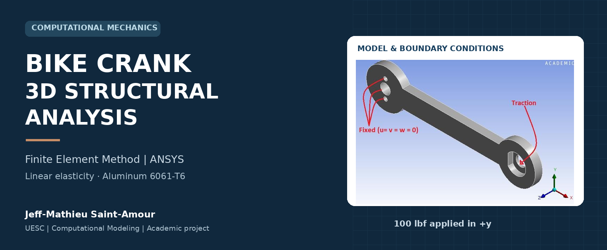
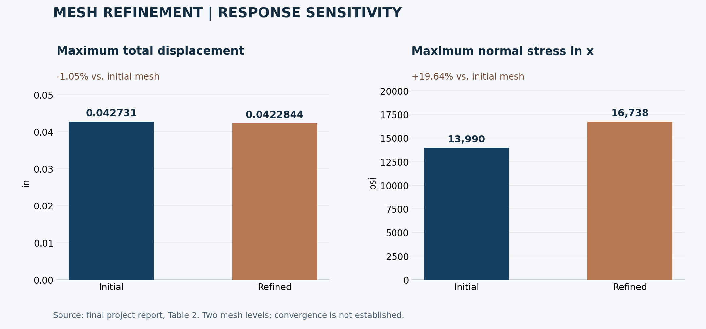
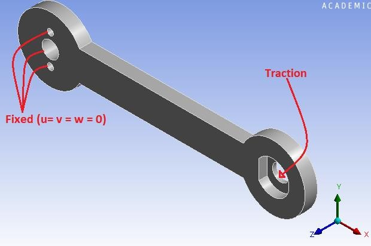
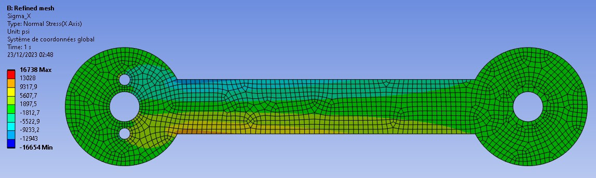
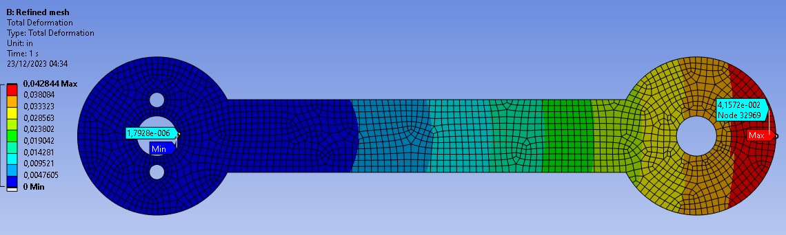
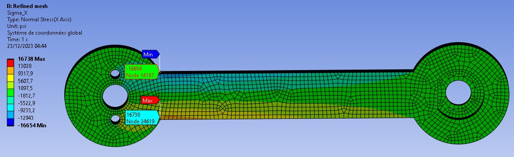
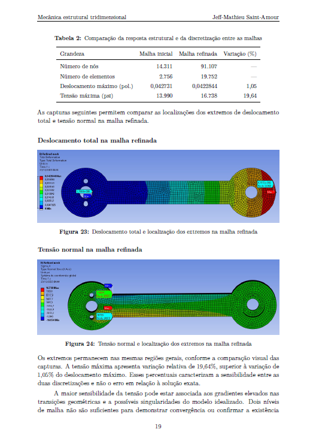

<p align="center">
  
</p>

<p align="center">
  <strong>Structural simulation · Numerical modeling · Mesh quality · Engineering interpretation</strong>
</p>

<p align="center">
  <a href="reports/3D_structural_mechanics_problem_Jeff_Mathieu_Bike_crank.pdf"><strong>Read the full report ↗</strong></a>
  &nbsp; · &nbsp;
  <a href="#key-results">Key results</a>
  &nbsp; · &nbsp;
  <a href="#visual-results">Visual results</a>
  &nbsp; · &nbsp;
  <a href="data/mesh_comparison.csv">Comparison data</a>
</p>

# Bike Crank | 3D Structural Mechanics

How does an aluminum bicycle crank respond to a prescribed load, and how much do the reported results change when its mesh is refined?

This academic project uses **ANSYS Static Structural** to examine displacement and normal stress in an **aluminum 6061-T6 crank**. It connects the governing equations of three-dimensional elasticity with model setup, local result inspection, and a comparison between two finite element meshes.

> **Main finding:** refining the mesh changes the maximum total displacement by **1.05%** and the reported maximum normal stress by **19.64%**. Local stress is more sensitive to this refinement than displacement. These two mesh levels do not establish convergence.

## The engineering problem

| Model component | Definition |
| --- | --- |
| Geometry | Three-dimensional bicycle crank, supplied in Parasolid format |
| Material | Aluminum 6061-T6; Young's modulus **10,000,000 psi**; Poisson's ratio **0.33** |
| Supports | Three holes in the support region fully fixed |
| Applied load | **100 lbf** in the positive **y** direction at the opposite end |
| Assumptions | Linear elasticity, small deformations, isotropic material |
| Discretization | MultiZone mesh with hexahedral elements |
| Outputs | Total displacement, normal stress, local probes, paths, and support reactions |

## Method

1. **Define the model.** Establish equilibrium, constitutive and kinematic relations, assumptions, and boundary conditions.
2. **Prepare and discretize the geometry.** Import the crank and assess skewness and orthogonal quality.
3. **Solve and inspect.** Examine displacement and stress fields using contour plots, probes, and extraction paths.
4. **Check consistency.** Review the fixed-hole displacements, support reactions, and expected bending behavior.
5. **Assess mesh sensitivity.** Halve the characteristic element sizes and compare the response and mesh-quality metrics.

The [methodology notes](docs/methodology.md) provide the model parameters and explain the scope of the checks.

## Key results



| Quantity | Initial mesh | Refined mesh | Absolute relative change |
| --- | ---: | ---: | ---: |
| Nodes | 14,311 | 91,107 | — |
| Elements | 2,756 | 19,752 | — |
| Body element size (in) | 0.15 | 0.075 | — |
| Hole-face element size (in) | 0.08 | 0.04 | — |
| Maximum total displacement (in) | 0.042731 | 0.0422844 | **1.05%** |
| Maximum normal stress in x (psi) | 13,990 | 16,738 | **19.64%** |
| Mean skewness | 0.173 | 0.119 | — |
| Elements with skewness > 0.50 | 0.44% | 0.16% | — |

Values are transcribed from Sections 2.4 and 3 and Tables 1–2 of the final report. Relative changes use the initial mesh as the reference. The chart displays the signed changes; the table reports their magnitudes.

### Engineering interpretation

- **Displacement:** the largest total displacement occurs toward the loaded end, while the constrained holes have prescribed zero displacement.
- **Stress:** the normal stress in x shows tensile and compressive regions consistent with bending, with higher magnitudes near geometric transitions close to the supports.
- **Mesh quality:** mean skewness and the proportion of elements above 0.50 decrease after refinement.
- **Sensitivity:** improved mesh-quality metrics do not, on their own, establish convergence of the local peak stress.

## Visual results

The images below are extracted from the final report and retain the original ANSYS annotations and units.

| Loading and supports | Refined mesh |
| --- | --- |
|  |  |

| Total displacement — refined mesh | Normal stress in x — refined mesh |
| --- | --- |
|  |  |

<details>
<summary><strong>Preview the report's response-comparison page</strong></summary>



</details>

## What this project demonstrates

**Finite element modeling:** translate an engineering problem into a three-dimensional elastic model with explicit assumptions and boundary conditions.

**Numerical assessment:** examine mesh quality, compare discretizations, and distinguish response sensitivity from numerical error.

**Technical communication:** combine mathematical formulation, solver outputs, tabulated results, and qualified engineering conclusions in a structured report.

## Scope and limitations

This is a documented academic simulation study. The comparisons support qualitative and numerical consistency checks; they do not constitute experimental validation, a completed convergence study, or a safety certification. Two meshes are insufficient to confirm a stress singularity. The beam-theory comparison also requires matching the physical section, probe location, and coordinate system.

The repository contains the **final report, selected figures, transcribed summary data, and a chart-generation script**. Native ANSYS project files, solver inputs, and the Parasolid geometry are not included, so the structural simulation cannot be rerun from this repository alone. The final PDF is preserved exactly as supplied by the author.

## Explore the repository

| Location | Contents |
| --- | --- |
| [reports/](reports/) | Final technical report in Portuguese |
| [assets/](assets/) | Portfolio banner, original result figures, and comparison chart |
| [data/mesh_comparison.csv](data/mesh_comparison.csv) | Two mesh summaries transcribed from the report |
| [docs/data_dictionary.md](docs/data_dictionary.md) | Field definitions, units, and source locations |
| [docs/methodology.md](docs/methodology.md) | Modeling choices, checks, and interpretation limits |
| [scripts/plot_mesh_comparison.py](scripts/plot_mesh_comparison.py) | Recreates the chart from the CSV; does not run ANSYS |

To regenerate the comparison chart:

```bash
python -m pip install -r requirements.txt
python scripts/plot_mesh_comparison.py
```

## Author and academic context

**Jeff-Mathieu Saint-Amour**  
M.Sc. in Computational Modeling in Science and Technology — UESC

Developed in the context of **Simulação para Problemas em Engenharia**, Graduate Program in Computational Modeling, **Universidade Estadual de Santa Cruz (UESC)**. Instructor: **Iram Barbaro Rivas Ortiz**. The report is dated **November 2024**.

The report includes the bibliography and the academic sources used in the study. The supplied geometry and original instructional context are acknowledged in the report; this portfolio presents the documented analysis and its results.
